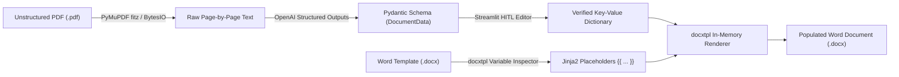

# 📄 AI PDF-to-Word Document Automation Agent

A production-ready Python & Streamlit web application that automates the extraction of structured entities from unstructured PDF documents (real estate title reports, contracts, legal filings, and invoices) and populates multi-page Microsoft Word (`.docx`) templates while preserving **100% of the original Word formatting**.

---

## ✨ Key Features

- **Layout-Independent AI Extraction:** Uses OpenAI Structured Outputs (`client.beta.chat.completions.parse` with `gpt-4o-mini` / `gpt-4o`) and strict **Pydantic** schemas (`DocumentData`) to extract standardized fields regardless of PDF layout variations.
- **Human-in-the-Loop (HITL) Verification:** Interactive verification interface supporting both **Desktop Table View (`st.data_editor`)** and **Mobile-Friendly Form View** so users can review and refine extracted values prior to final export.
- **Zero Formatting Loss (`.docx` Jinja2 Engine):** Powered by `docxtpl`, automatically detecting `{{ variable_name }}` placeholders inside uploaded Word templates and injecting verified data into tables, headers, and paragraphs without altering fonts, margins, or styles.
- **Zero Disk Persistence:** Processes all PDFs and `.docx` files strictly in memory (`io.BytesIO`) for enterprise data privacy.
- **One-Click Built-in Demo Generator:** Includes `sample_generator.py` to create a realistic Real Estate Title Report PDF and matching `.docx` Closing Template on the fly—plus an Offline Demo Fallback mode so you can test the entire workflow immediately.

---

## 🏗️ Architecture & Workflow



---

## 📂 Repository Structure

```text
.
├── app.py                  # Main Streamlit web application & 3-step responsive UI
├── extractor.py            # PDF text parsing (PyMuPDF) & OpenAI Structured Outputs module
├── doc_generator.py        # Word template variable inspector & rendering engine (docxtpl)
├── schemas.py              # Pydantic data models (DocumentData) for structured extraction
├── sample_generator.py     # Built-in generator for sample Title Report PDF & Word template
├── requirements.txt        # Python dependencies
├── .env.example            # Example environment variables (OPENAI_API_KEY)
└── README.md               # Setup instructions, architecture diagram, and usage guide
```

---

## 🚀 Quick Start & Local Setup

### 1. Create and Activate Virtual Environment

```bash
# Windows (PowerShell)
python -m venv .venv
.\.venv\Scripts\Activate.ps1

# macOS / Linux
python3 -m venv .venv
source .venv/bin/activate
```

### 2. Install Dependencies

```bash
pip install -r requirements.txt
```

### 3. Configure Environment Variables (Optional)

Copy `.env.example` to `.env` and add your OpenAI API key (or enter it directly in the app sidebar):

```bash
cp .env.example .env
```

```env
OPENAI_API_KEY=sk-your-openai-api-key-here
```

### 4. Launch the Application

```bash
streamlit run app.py
```

---

## 📝 How to Format Word (`.docx`) Templates

Insert standard Jinja2 tags (`{{ variable_name }}`) anywhere inside your Microsoft Word (`.docx`) document—including paragraphs, tables, headers, or footers:

| Jinja2 Placeholder Tag | Description |
| :--- | :--- |
| `{{ client_name }}` | Full name of primary client, buyer, or property owner |
| `{{ entity_address }}` | Full street address, city, state, and ZIP code |
| `{{ reference_id }}` | Parcel ID, APN, Policy Number, or Contract Reference ID |
| `{{ effective_date }}` | Effective, issue, or recording date (`YYYY-MM-DD`) |
| `{{ institution_name }}` | Lender, bank, title company, or issuing organization |
| `{{ total_amount }}` | Monetary amount, loan value, or valuation with currency symbol |
| `{{ legal_description }}` | Brief property legal description or contract scope |
| `{{ key_summary }}` | Concise 2-sentence executive summary of key terms/obligations |

---

## 🧪 Instant Testing with Sample Files

1. Run `streamlit run app.py`.
2. In the left sidebar, click **"✨ Generate Sample Test Files"**.
3. Click **"🚀 Run AI Extraction Pipeline"** in Step 2.
4. Review or edit any field in the **Human-in-the-Loop** table/form.
5. Click **"📥 Download Populated Word Document (.docx)"** in Step 3.


